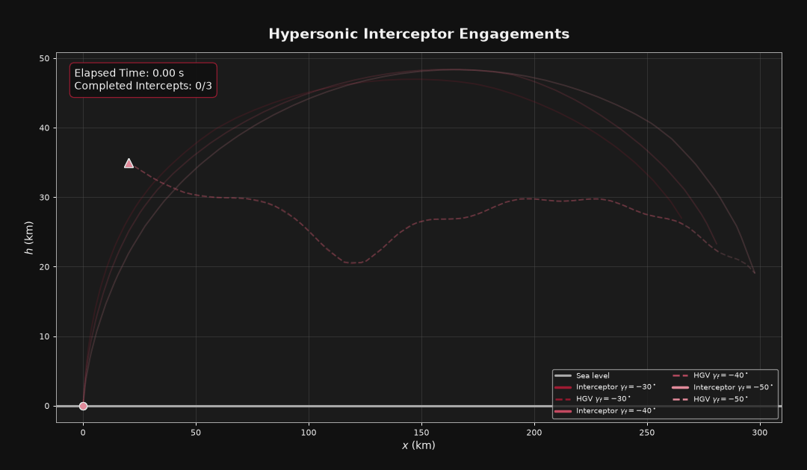
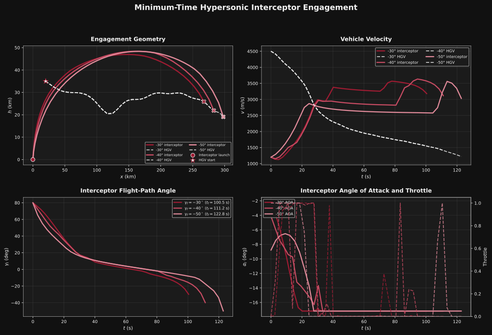

========================================
Minimum-Time Hypersonic Glide Intercept
========================================

Missile Defense Motivation
==========================

Hypersonic glide vehicles (HGVs) present a significant challenge for modern missile defense systems because of their extremely high velocities, maneuverability, and ability to operate along nontraditional flight paths. Unlike conventional ballistic missiles, which generally follow more predictable trajectories after boost, HGVs can maneuver throughout portions of their flight. This makes predicting their future position and determining an effective interception trajectory considerably more difficult.

A successful missile defense engagement requires more than simply detecting and tracking an incoming threat. The interceptor must be able to reach the target while accounting for its own aerodynamic limitations, available propulsion, and changing flight conditions. Because both vehicles are moving simultaneously, even relatively small differences in velocity, position, or maneuvering behavior can significantly affect the interception geometry.

Optimal control provides a useful framework for studying these engagement problems. By modeling the interceptor and target together, it is possible to determine control histories that satisfy interception constraints while optimizing a performance objective. In this example, the objective is to minimize the time required for an interceptor to engage a maneuvering hypersonic glide vehicle.

This example demonstrates how numerical optimal-control methods can be applied to a simplified missile defense engagement. It focuses on the coupled vehicle dynamics, aerodynamic forces, propulsion constraints, and terminal interception geometry rather than modeling a complete operational missile defense system.

Problem Description
===================

In this example, we compute the minimum-time interception trajectory for a powered interceptor engaging an unpowered hypersonic glide vehicle (HGV) in a vertical plane. The interceptor launches from sea level and attempts to intercept the HGV while satisfying a prescribed terminal flight-path angle.

The interceptor is modeled as a powered point-mass vehicle with aerodynamic lift and drag. The HGV is modeled as an unpowered point-mass vehicle with a prescribed time-varying angle of attack. Both vehicles are propagated simultaneously using a common time variable.

State and Control Variables
===========================

The combined state and control vectors are defined as

.. math::

    \vec{X} =
    [x_I,h_I,v_I,\gamma_I,m_I,x_T,h_T,v_T,\gamma_T]^T

    \quad \quad

    \vec{U} = [\alpha_I,\delta]

where :math:`x` is downrange position, :math:`h` is altitude, :math:`v` is velocity magnitude, :math:`\gamma` is flight-path angle, :math:`m_I` is interceptor mass, :math:`\alpha_I` is interceptor angle of attack, and :math:`\delta` is throttle.

The subscripts :math:`I` and :math:`T` denote the interceptor and target, respectively. The resulting system consists of nine state equations and two interceptor control inputs.

Equations of Motion
===================

The equations of motion for either vehicle are based on the point-mass equations

.. math::

    \dot{x} = v\cos(\gamma)

    \dot{h} = v\sin(\gamma)

    \dot{v} =
    \frac{T\cos(\alpha)-D}{m}
    -g\sin(\gamma)

    \dot{\gamma} =
    \frac{L+T\sin(\alpha)}{mv}
    -\frac{g\cos(\gamma)}{v}

For the interceptor, the mass flow rate is determined by the propulsion system specific impulse.

.. math::

    \dot{m}_I = -\frac{T}{I_{sp}g_0}

The HGV is unpowered, so its thrust and mass flow rate are zero. Its angle of attack is prescribed as a time-varying maneuver.

.. math::

    \alpha_T(t) =
    \alpha_{T,0}+A_T\sin(\omega_T t)

Aerodynamic and Propulsion Models
=================================

The aerodynamic forces are calculated using dynamic pressure and the vehicle aerodynamic coefficients.

.. math::

    q = \frac{1}{2}\rho v^2

    \quad \quad

    L = qSC_L

    \quad \quad

    D = qSC_D

The atmospheric density is modeled using an exponential atmosphere.

.. math::

    \rho(h) = \rho_0\exp\left(-\frac{h}{H}\right)

The interceptor thrust is controlled through the throttle command.

.. math::

    T_I = \delta T_{\max}

The throttle is bounded between zero and one, while interceptor angle of attack is constrained by the prescribed control limits.

Optimal-Control Formulation
===========================

The interception problem is formulated as a minimum-time optimal-control problem. The objective is to minimize the final time required for the interceptor to reach the HGV.

.. math::

    J = t_f

The initial interceptor and HGV conditions are specified independently. The interceptor begins at sea level with an initial ascending flight-path angle, while the HGV begins at a prescribed downrange distance and altitude with hypersonic velocity.

Interception is enforced by requiring the interceptor and HGV to occupy the same position at the final time.

.. math::

    x_I(t_f) = x_T(t_f)

    \quad \quad

    h_I(t_f) = h_T(t_f)

The interceptor terminal flight-path angle is also prescribed. To examine the effect of terminal geometry on the optimized engagement, the problem is solved for three different terminal flight-path angles.

.. math::

    \gamma_I(t_f) \in
    \{-30^\circ,-40^\circ,-50^\circ\}

The resulting trajectories provide a comparison of minimum-time engagement solutions under different terminal flight-path-angle requirements.

ASSET Implementation
====================

The combined interceptor-target dynamics are implemented as an ASSET ODE. The ODE uses nine state variables and two control variables, with time as the independent variable. An ASSET phase is then constructed with the initial conditions, terminal interception constraints, control bounds, and minimum-time objective.

The initial trajectory is generated using an initial guess for the interceptor and target trajectories. The ASSET optimizer then determines the control history and final time that satisfy the interception constraints.

The optimized trajectories are plotted and animated to compare the three terminal-angle cases. The animation displays all cases on a common time axis. Each case remains at its terminal position after completing its interception, allowing the remaining cases to continue.

Optimized Trajectory Results
============================

The trajectory comparison illustrates how changing the prescribed terminal flight-path angle affects the resulting engagement geometry and minimum-time solution.

Full Code
=========

The complete Python implementation is included below.

.. literalinclude:: ../../examples/HypersonicIntercept.py
   :language: python
   :linenos:
   :caption: HypersonicIntercept.py
