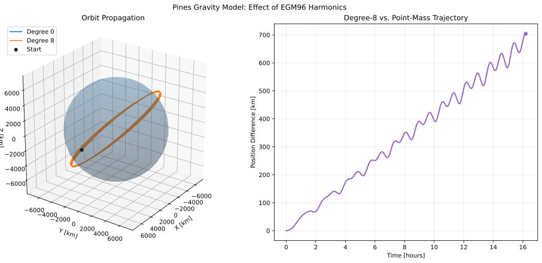

Pines Gravity Model
===================

This example demonstrates the use of ASSET's native Pines gravity kernel for
evaluating high-fidelity gravitational acceleration and propagating orbital
trajectories. The example uses spherical harmonic gravity coefficients from
the EGM96 gravity model and compares a point-mass gravity solution against a
degree-8 spherical harmonic solution.

The Pines gravity implementation provides gravitational acceleration through
an ASSET VectorFunction interface. This allows the gravity model to be used
directly within ASSET dynamics and provides access to derivatives such as the
acceleration Jacobian.

The example demonstrates four primary capabilities:

#. Constructing Pines gravity models at different spherical harmonic degrees.
#. Evaluating gravitational acceleration and comparing it against point-mass gravity.
#. Computing derivatives of the gravitational acceleration VectorFunction.
#. Propagating orbital trajectories using point-mass and spherical harmonic gravity.

.. note::

   The example uses publicly available EGM96 gravity coefficients. The
   coefficient file is loaded from the repository's native data directory.
   The gravity model is evaluated in a fixed body-centered coordinate frame.
   Earth rotation and time-dependent transformations between inertial and
   body-fixed frames are not included in this example.

Gravity Model
-------------

The gravitational acceleration is evaluated using the Pines gravity kernel.
The kernel includes central gravity and the selected spherical harmonic
perturbations.

The gravitational model is parameterized by the gravitational parameter
:math:`\mu`, reference radius :math:`R_E`, maximum spherical harmonic degree
:math:`N`, and a set of fully normalized spherical harmonic coefficients.

The constants used in this example are

.. math::

   \begin{aligned}
   \mu &= 3.9860043543609598 \times 10^5
   \;\mathrm{km^3/s^2}, \\
   R_E &= 6378.1363 \;\mathrm{km}.
   \end{aligned}

The gravity coefficients are read from the EGM96 coefficient file:

.. code-block:: python

   COEFF_FILE = str(
       Path(__file__).resolve().parents[1]
       / "native"
       / "data"
       / "egm96.nor"
   )

The gravity model is constructed using :code:`astro.PinesGravity`, which
accepts the coefficient file, maximum degree, gravitational parameter,
reference radius, and coefficient normalization convention.

.. code-block:: python

   @lru_cache(maxsize=None)
   def MakePines(degree):
       """
       Build each gravity model once; coefficient parsing can take time.
       """
       return astro.PinesGravity(
           COEFF_FILE,
           degree,
           MU,
           RE,
           "fully_normalized"
       )

The :code:`lru_cache` decorator ensures that each requested gravity model is
constructed only once. This avoids repeatedly parsing the coefficient file
when the same harmonic degree is used for multiple acceleration evaluations
or propagations.

Gravity Evaluation
------------------

The first part of the example evaluates gravitational acceleration at a
single position. The selected position is

.. math::

   \mathbf{r} =
   \begin{bmatrix}
   4510 \\
   -3120 \\
   5230
   \end{bmatrix}
   \;\mathrm{km}.

For comparison, the point-mass gravitational acceleration is calculated
analytically using

.. math::

   \mathbf{a}_{2B}
   =
   -\frac{\mu}{r^3}\mathbf{r},

where

.. math::

   r = \|\mathbf{r}\|.

The Pines gravity kernel is evaluated at spherical harmonic degrees
0, 2, 8, and 20. Degree zero represents the central point-mass contribution,
while increasing the maximum degree includes additional spherical harmonic
terms.

.. code-block:: python

   position = np.array([4510.0, -3120.0, 5230.0])
   radius = np.linalg.norm(position)
   two_body = -MU * position / radius**3

   print("Degree   |a| [km/s^2]       |a - a_2body| [km/s^2]")

   for degree in [0, 2, 8, 20]:
       gravity = MakePines(degree)
       acceleration = np.asarray(gravity.acceleration(position))
       difference = np.linalg.norm(acceleration - two_body)

       print(
           f"{degree:6d}   "
           f"{np.linalg.norm(acceleration):.12e}   "
           f"{difference:.12e}"
       )

The acceleration magnitude and difference from the analytical point-mass
solution provide a basic comparison of the gravity models. The difference
measures the perturbing contribution relative to central gravity at the
selected position.

Acceleration Derivatives
------------------------

In addition to evaluating acceleration, the Pines VectorFunction interface
can provide derivatives of the gravitational acceleration.

For a position vector :math:`\mathbf{r}`, the acceleration Jacobian is

.. math::

   \frac{\partial \mathbf{a}}{\partial \mathbf{r}}
   =
   \begin{bmatrix}
   \dfrac{\partial a_x}{\partial x} &
   \dfrac{\partial a_x}{\partial y} &
   \dfrac{\partial a_x}{\partial z} \\
   \dfrac{\partial a_y}{\partial x} &
   \dfrac{\partial a_y}{\partial y} &
   \dfrac{\partial a_y}{\partial z} \\
   \dfrac{\partial a_z}{\partial x} &
   \dfrac{\partial a_z}{\partial y} &
   \dfrac{\partial a_z}{\partial z}
   \end{bmatrix}.

This derivative describes how the gravitational acceleration changes with
position and is useful for sensitivity analysis, variational equations, and
gradient-based optimization.

The degree-8 gravity model is used to demonstrate Jacobian evaluation:

.. code-block:: python

   gravity8 = MakePines(8)

   acceleration, jacobian = gravity8.compute_jacobian(position)

   print(
       "\nDegree-8 acceleration [km/s^2]:",
       np.asarray(acceleration)
   )

   print(
       "Acceleration Jacobian [1/s^2]:\n",
       np.asarray(jacobian)
   )

The :code:`compute_jacobian` method returns both the acceleration and its
Jacobian with respect to the input position.

Orbital Dynamics
----------------

To demonstrate the use of the Pines gravity kernel in an ASSET propagation,
the gravitational acceleration is incorporated into a six-state orbital
dynamics model.

The state is defined as

.. math::

   \mathbf{x}
   =
   \begin{bmatrix}
   \mathbf{r} \\
   \mathbf{v}
   \end{bmatrix},

where :math:`\mathbf{r}` and :math:`\mathbf{v}` are the position and velocity
vectors, respectively.

The equations of motion are

.. math::

   \begin{aligned}
   \dot{\mathbf{r}} &= \mathbf{v}, \\
   \dot{\mathbf{v}} &= \mathbf{a}_{\mathrm{Pines}}(\mathbf{r}).
   \end{aligned}

The acceleration function includes central gravity and the selected
spherical harmonic perturbations.

The dynamics are implemented using :code:`oc.ODEBase`:

.. code-block:: python

   class PinesModel(oc.ODEBase):
       """
       Orbital state dynamics using Pines gravity.

       The Pines model evaluates gravity at a body-fixed position. This simple
       example holds that frame fixed and does not model Earth rotation.
       """

       def __init__(self, gravity):
           xvars = 6
           args = oc.ODEArguments(xvars, 0)

           position = args.head3()
           velocity = args.segment3(3)

           acceleration = gravity(position)
           ode = vf.stack([velocity, acceleration])

           super().__init__(ode, xvars)

The gravity model is passed directly into the dynamics constructor. This
preserves the ASSET VectorFunction representation of the acceleration and
allows the resulting ODE to be integrated using ASSET's numerical integrators.

Initial Conditions
------------------

The propagation begins with a circular orbit at an initial radius of
:math:`7000` km. The orbit is inclined by :math:`51.6^\circ`, representative
of an inclined low Earth orbit.

For a circular point-mass orbit, the initial velocity magnitude is

.. math::

   v_0 = \sqrt{\frac{\mu}{r_0}}.

The initial position and velocity are

.. math::

   \begin{aligned}
   \mathbf{r}_0 &=
   \begin{bmatrix}
   7000 \\
   0 \\
   0
   \end{bmatrix}
   \;\mathrm{km}, \\[1em]
   \mathbf{v}_0 &=
   \begin{bmatrix}
   0 \\
   v_0\cos(51.6^\circ) \\
   v_0\sin(51.6^\circ)
   \end{bmatrix}
   \;\mathrm{km/s}.
   \end{aligned}

The initial state is constructed in Python as follows:

.. code-block:: python

   initial_radius = 7000.0
   initial_speed = np.sqrt(MU / initial_radius)
   inclination = np.deg2rad(51.6)

   initial_state = np.zeros(7)

   initial_state[0:3] = [
       initial_radius,
       0.0,
       0.0
   ]

   initial_state[3:6] = [
       0.0,
       initial_speed * np.cos(inclination),
       initial_speed * np.sin(inclination)
   ]

The initial state contains seven entries because the integrator's trajectory
output includes time as an additional variable. The ODE itself contains six
state variables.

The orbital period of the corresponding point-mass circular orbit is

.. math::

   T = 2\pi\sqrt{\frac{r_0^3}{\mu}}.

The propagation duration is selected as ten orbital periods:

.. code-block:: python

   period = 2.0 * np.pi * np.sqrt(initial_radius**3 / MU)
   final_time = 10.0 * period

Orbit Propagation
-----------------

Two gravity models are propagated using the same initial conditions:

#. Degree 0: central point-mass gravity.
#. Degree 8: EGM96 spherical harmonic gravity through degree 8.

Both models use an ASSET integrator with a nominal integration step of
30 seconds and an absolute tolerance of :math:`10^{-8}`.

.. code-block:: python

   trajectories = {}

   for degree in [0, 8]:
       ode = PinesModel(MakePines(degree))

       integrator = ode.integrator(30.0)
       integrator.setAbsTol(1.0e-8)

       trajectories[degree] = np.asarray(
           integrator.integrate_dense(
               initial_state,
               final_time,
               2000
           )
       ).T

The resulting trajectories contain position, velocity, and time histories.
The two trajectories can therefore be compared at matching output times.

Point-Mass Propagation Check
----------------------------

A separate propagation using the degree-zero model checks the expected
half-period behavior of a circular orbit.

After half an orbital period, a circular two-body trajectory should reach
the position opposite its initial position:

.. math::

   \mathbf{r}\left(\frac{T}{2}\right)
   =
   -\mathbf{r}(0).

The position error is calculated as

.. math::

   e_r =
   \left\|
   \mathbf{r}\left(\frac{T}{2}\right)
   +
   \mathbf{r}(0)
   \right\|.

The implementation is

.. code-block:: python

   ode0 = PinesModel(MakePines(0))

   integrator0 = ode0.integrator(30.0)
   integrator0.setAbsTol(1.0e-8)

   half_period_state = np.asarray(
       integrator0.integrate(
           initial_state,
           period / 2.0
       )
   )

   half_period_error = np.linalg.norm(
       half_period_state[0:3] + initial_state[0:3]
   )

   print(
       f"\nHalf-period position error [km]: "
       f"{half_period_error:.3e}"
   )

This provides a basic numerical check of the degree-zero gravity propagation
against the expected circular-orbit geometry.

Trajectory Comparison
---------------------

The difference between the degree-8 and degree-zero position histories is
calculated at each output time:

.. math::

   \Delta r(t)
   =
   \left\|
   \mathbf{r}_{8}(t)
   -
   \mathbf{r}_{0}(t)
   \right\|.

where :math:`\mathbf{r}_{8}` is the degree-8 position and
:math:`\mathbf{r}_{0}` is the point-mass position.

The position difference is computed using

.. code-block:: python

   time_hours = trajectories[0][6] / 3600.0

   position_difference = np.linalg.norm(
       trajectories[8][0:3] - trajectories[0][0:3],
       axis=0
   )

The comparison illustrates the accumulated trajectory separation caused by
the spherical harmonic perturbations included in the degree-8 model.

The plotting routine displays the two propagated trajectories around a
spherical representation of Earth, along with the position difference as a
function of propagation time.

   Comparison of point-mass and degree-8 Pines gravity propagation over
   ten nominal orbital periods.

Earth Surface Visualization
---------------------------

For visualization, a spherical Earth surface is generated using the reference
radius :math:`R_E`. The surface is not used in the gravity calculation; it is
included only to provide a spatial reference for the propagated trajectories.

The surface is constructed from longitude and latitude coordinates:

.. math::

   \begin{aligned}
   x &= R_E\cos(\phi)\cos(\lambda), \\
   y &= R_E\cos(\phi)\sin(\lambda), \\
   z &= R_E\sin(\phi).
   \end{aligned}

where :math:`\phi` is latitude and :math:`\lambda` is longitude.

.. code-block:: python

   def make_earth_surface():
       longitude = np.linspace(0.0, 2.0 * np.pi, 40)
       latitude = np.linspace(-np.pi / 2.0, np.pi / 2.0, 20)

       longitude, latitude = np.meshgrid(longitude, latitude)

       x = RE * np.cos(latitude) * np.cos(longitude)
       y = RE * np.cos(latitude) * np.sin(longitude)
       z = RE * np.sin(latitude)

       return x, y, z

The resulting surface is plotted with partial transparency so that both
orbital trajectories remain visible.

Full Code
---------

The complete example is shown below.

.. code-block:: python

   # -*- coding: utf-8 -*-
   """
   Example use of ASSET's Pines gravity kernel.
   """

   from functools import lru_cache
   from pathlib import Path

   import numpy as np
   import asset_asrl as ast
   import matplotlib.pyplot as plt

   vf = ast.VectorFunctions
   oc = ast.OptimalControl
   astro = ast.Astro

   MU = 3.9860043543609598e5
   RE = 6378.1363

   COEFF_FILE = str(
       Path(__file__).resolve().parents[1]
       / "native"
       / "data"
       / "egm96.nor"
   )

   @lru_cache(maxsize=None)
   def MakePines(degree):
       """
       Build each gravity model once; coefficient parsing can take time.
       """
       return astro.PinesGravity(
           COEFF_FILE,
           degree,
           MU,
           RE,
           "fully_normalized"
       )

   class PinesModel(oc.ODEBase):
       """
       Orbital state dynamics using Pines gravity.

       The Pines model evaluates gravity at a body-fixed position. This simple
       example holds that frame fixed and does not model Earth rotation.
       """

       def __init__(self, gravity):
           xvars = 6
           args = oc.ODEArguments(xvars, 0)

           position = args.head3()
           velocity = args.segment3(3)

           acceleration = gravity(position)
           ode = vf.stack([velocity, acceleration])

           super().__init__(ode, xvars)

   def make_earth_surface():
       longitude = np.linspace(0.0, 2.0 * np.pi, 40)
       latitude = np.linspace(-np.pi / 2.0, np.pi / 2.0, 20)
       longitude, latitude = np.meshgrid(longitude, latitude)

       x = RE * np.cos(latitude) * np.cos(longitude)
       y = RE * np.cos(latitude) * np.sin(longitude)
       z = RE * np.sin(latitude)

       return x, y, z

   if __name__ == "__main__":

       position = np.array([4510.0, -3120.0, 5230.0])
       radius = np.linalg.norm(position)
       two_body = -MU * position / radius**3

       print("Degree   |a| [km/s^2]       |a - a_2body| [km/s^2]")

       for degree in [0, 2, 8, 20]:
           gravity = MakePines(degree)
           acceleration = np.asarray(gravity.acceleration(position))
           difference = np.linalg.norm(acceleration - two_body)

           print(
               f"{degree:6d}   "
               f"{np.linalg.norm(acceleration):.12e}   "
               f"{difference:.12e}"
           )

       # Show that the Pines VectorFunction can also provide derivatives.
       gravity8 = MakePines(8)
       acceleration, jacobian = gravity8.compute_jacobian(position)

       print(
           "\nDegree-8 acceleration [km/s^2]:",
           np.asarray(acceleration)
       )

       print(
           "Acceleration Jacobian [1/s^2]:\n",
           np.asarray(jacobian)
       )

       # Circular orbit initial state, inclined by 51.6 degrees.
       initial_radius = 7000.0
       initial_speed = np.sqrt(MU / initial_radius)
       inclination = np.deg2rad(51.6)

       initial_state = np.zeros(7)
       initial_state[0:3] = [initial_radius, 0.0, 0.0]

       initial_state[3:6] = [
           0.0,
           initial_speed * np.cos(inclination),
           initial_speed * np.sin(inclination)
       ]

       period = 2.0 * np.pi * np.sqrt(initial_radius**3 / MU)
       final_time = 10.0 * period

       # Integrate point-mass and degree-8 gravity models.
       trajectories = {}

       for degree in [0, 8]:
           ode = PinesModel(MakePines(degree))
           integrator = ode.integrator(30.0)
           integrator.setAbsTol(1.0e-8)

           trajectories[degree] = np.asarray(
               integrator.integrate_dense(
                   initial_state,
                   final_time,
                   2000
               )
           ).T

       # Degree-zero circular-orbit half-period check.
       ode0 = PinesModel(MakePines(0))
       integrator0 = ode0.integrator(30.0)
       integrator0.setAbsTol(1.0e-8)

       half_period_state = np.asarray(
           integrator0.integrate(
               initial_state,
               period / 2.0
           )
       )

       half_period_error = np.linalg.norm(
           half_period_state[0:3] + initial_state[0:3]
       )

       print(
           f"\nHalf-period position error [km]: "
           f"{half_period_error:.3e}"
       )

       # Difference between the two trajectories at matching output times.
       time_hours = trajectories[0][6] / 3600.0

       position_difference = np.linalg.norm(
           trajectories[8][0:3] - trajectories[0][0:3],
           axis=0
       )

       # Plot orbits in 3D with Earth for scale, plus trajectory separation.
       fig = plt.figure(figsize=(13, 6), constrained_layout=True)

       orbit_ax = fig.add_subplot(1, 2, 1, projection="3d")
       difference_ax = fig.add_subplot(1, 2, 2)

       earth_x, earth_y, earth_z = make_earth_surface()

       orbit_ax.plot_surface(
           earth_x,
           earth_y,
           earth_z,
           color="steelblue",
           alpha=0.25,
           linewidth=0,
           shade=True
       )

       colors = {
           0: "tab:blue",
           8: "tab:orange"
       }

       for degree in [0, 8]:
           trajectory = trajectories[degree]

           orbit_ax.plot(
               trajectory[0],
               trajectory[1],
               trajectory[2],
               color=colors[degree],
               linewidth=1.6,
               label=f"Degree {degree}"
           )

       orbit_ax.scatter(
           [initial_state[0]],
           [initial_state[1]],
           [initial_state[2]],
           color="black",
           s=24,
           label="Start"
       )

       limit = 1.12 * initial_radius

       orbit_ax.set(
           xlim=(-limit, limit),
           ylim=(-limit, limit),
           zlim=(-limit, limit),
           xlabel="X [km]",
           ylabel="Y [km]",
           zlabel="Z [km]",
           title="Orbit Propagation"
       )

       orbit_ax.set_box_aspect((1, 1, 1))
       orbit_ax.view_init(elev=25, azim=35)
       orbit_ax.legend(loc="upper left")
       orbit_ax.grid(True, alpha=0.3)

       difference_ax.plot(
           time_hours,
           position_difference,
           color="tab:purple",
           linewidth=2
       )

       difference_ax.scatter(
           [time_hours[-1]],
           [position_difference[-1]],
           color="tab:purple",
           s=30,
           zorder=3
       )

       difference_ax.set(
           xlabel="Time [hours]",
           ylabel="Position Difference [km]",
           title="Degree-8 vs. Point-Mass Trajectory"
       )

       difference_ax.grid(True, alpha=0.3)

       fig.suptitle(
           "Pines Gravity Model: Effect of EGM96 Harmonics"
       )

       fig.savefig(
           Path(__file__).resolve().parents[1]
           / "docs"
           / "_static"
           / "PinesGravity.svg",
           format="svg",
           bbox_inches="tight"
       )

       plt.show()

Implementation Notes
--------------------

This example illustrates several features of ASSET's Pines gravity
implementation:

* **Native gravity evaluation:** The Pines kernel evaluates gravitational
  acceleration using spherical harmonic coefficients from EGM96.
* **Selectable harmonic degree:** The maximum degree can be changed when
  constructing the gravity model.
* **VectorFunction integration:** The gravity model is called directly
  from an ASSET ODE.
* **Derivative evaluation:** The acceleration VectorFunction provides a
  Jacobian through :code:`compute_jacobian`.
* **Trajectory comparison:** The example compares point-mass and
  degree-8 gravity propagation over ten nominal circular-orbit periods.

The example deliberately uses a fixed body-centered frame. A production
high-fidelity Earth gravity propagation would also need to account for the
transformation between the propagation frame and the body-fixed gravity
frame, including Earth rotation and any desired time-dependent Earth
orientation effects.

References
----------

#. Pines, S. "Uniform Representation of the Gravitational Potential and its
   Derivatives." AIAA Journal, 1973.
#. Lemoine, F. G., et al. "The Development of the Joint NASA GSFC and the
   National Imagery and Mapping Agency (NIMA) Geopotential Model EGM96."
   NASA/TP-1998-206861, 1998.
